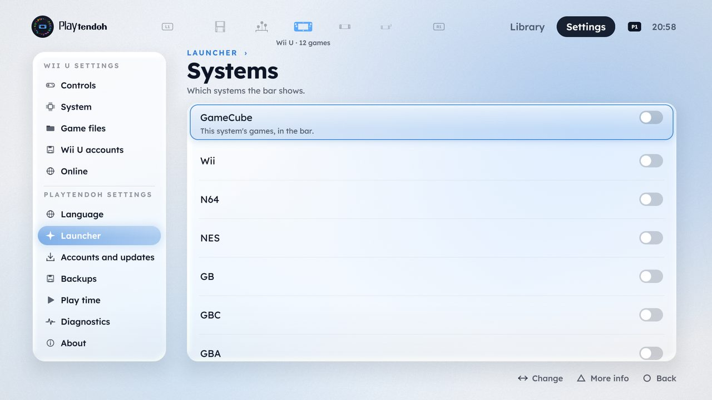

# The classics

The older Nintendo systems play on libretro cores built into Playtendoh, each on a side of its own with
the same Library, settings and in-game menu as the others, plus CRT filters, the cores' own options,
RetroAchievements and cheats.

## Turn them on {#turn-on}

> [!IMPORTANT]
> The classic systems start **hidden**. Show the ones you want from **Settings > Launcher > Systems**: each
> has its own switch (N64, NES, GB, GBC, GBA, SNES and the rest).

## What you need {#what-you-need}

- **Your games**, dumped from your own cartridges and disks.
- A **BIOS** only for the Famicom Disk System and the Satellaview ([below](#bios)).

## Every system's folder {#games}

| System | Games folder | Formats | Core |
|---|---|---|---|
| Nintendo 64 | `/data/PS5N64/games` | `.z64`, `.n64`, `.v64`, `.rom`, `.zip` | ParaLLEl-N64 |
| iQue Player | `/data/PS5iQue/games` | decrypted iQue games: `.z64`, `.n64`, `.v64`, `.zip` | ParaLLEl-N64 |
| NES | `/data/PS5NES/games` | `.nes`, `.unf`, `.unif`, `.fds`, `.zip`, `.7z` | Mesen |
| Famicom Disk System | `/data/PS5FDS/games` | `.fds` | Mesen |
| VS. System | `/data/PS5VS/games` | `.nes`, `.zip`, `.7z` | Mesen |
| Super Nintendo | `/data/PS5SNES/games` | `.sfc`, `.smc`, `.swc`, `.fig`, `.bs`, `.st`, `.zip`, `.7z` | Mesen-S |
| Satellaview | `/data/PS5Satellaview/games` | `.bs` | Mesen-S |
| Game Boy | `/data/PS5GBC/games` | `.gb`, `.zip`, `.7z` | mGBA |
| Game Boy Color | `/data/PS5GBC/games` | `.gbc`, `.zip`, `.7z` | mGBA |
| Super Game Boy | `/data/PS5SGB/games` | `.gb`, `.gbc`, `.zip`, `.7z` | mGBA |
| Game Boy Advance | `/data/PS5GBA/games` | `.gba`, `.zip`, `.7z` | mGBA |
| Virtual Boy | `/data/PS5VB/games` | `.vb`, `.vboy`, `.zip`, `.7z` | Beetle VB |
| Pokémon mini | `/data/PS5PokeMini/games` | `.min` | PokeMini |
| Game & Watch | `/data/PS5GW/games` | `.mgw` | gw-libretro |

Each side's **Settings > Game files** says its folder, and can choose another, a
[network share](files.md#network-shares) too. A game in a `.zip` or `.7z` is one game an archive.

## BIOS files {#bios}

Each goes in the **`system`** folder beside that system's `games` folder, dumped from your own console:

| System | File | Needed? |
|---|---|---|
| Famicom Disk System | `disksys.rom` (8 KB) in `/data/PS5FDS/system` | **Yes** |
| Satellaview | `BS-X.bin` in `/data/PS5Satellaview/system` | **Yes** |
| Game Boy | `gb_bios.bin` in `/data/PS5GBC/system` | Optional |
| Game Boy Color | `gbc_bios.bin` in `/data/PS5GBC/system` | Optional |
| Super Game Boy | `sgb_bios.bin` in `/data/PS5SGB/system` | Optional |
| Game Boy Advance | `gba_bios.bin` in `/data/PS5GBA/system` | Optional |
| Pokémon mini | `bios.min` in `/data/PS5PokeMini/system` | Optional |

The optional ones have a built-in stand-in that most games are fine with. The Setup check has a row for
each.

## Settings {#settings}

| Page | What's there |
|---|---|
| **Emulator** | Every one of the core's own options, for every game on the system |
| **Picture and sound** | CRT filters and the rest of the picture, and the sound |
| **Game files** | The games folder, Look for games now, network shares |
| **Online** | Box art, from libretro's thumbnails by the game file's name |

A game's own **Game settings** has the Emulator and Picture and sound pages for that game, and
**Cheats**: get the game's cheats, and turn each on or off.

## Special controllers {#special-controllers}

The DualSense stands in for the NES's **Arkanoid paddle**, **Zapper** and **Power Pad**, the SNES **Mouse**
and **Super Scope**, and **tilt** for the Game Boy games that read it, each plugged in for the games that
use it.

## RetroAchievements {#achievements}

Sign in once in **Settings > Accounts and updates > RetroAchievements**, and the N64, SNES, NES, Game Boys,
Virtual Boy and Pokémon mini earn achievements (with the DS, GameCube and Wii).

## NES HD packs {#hd-packs}

Mesen's HD texture packs work: unzip a pack into `/data/PS5NES/system/HdPacks/<the game file's name>/`
(its `hires.txt` directly in there), or put the pack's `.zip` in `HdPacks` as it is. For a game named
`Super Mario Bros. (World).nes`, that's `HdPacks/Super Mario Bros. (World)/hires.txt`. A Famicom Disk
System pack goes in `/data/PS5FDS/system/HdPacks/`.
