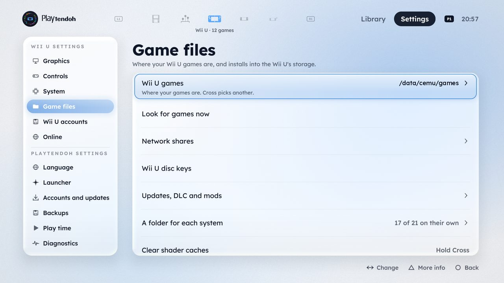

# Where your files go

**Put your games anywhere.** On a USB drive, the extended storage, in `/data/playtendoh` (a folder made for
you) or `/data/homebrew`, in any folders: one per console, or all together. Playtendoh finds them as it
starts and when you plug in a drive, and plays them where they are ([how it looks](setup-check.md#finding-games)).
BIOS files, Switch keys and firmware, and the Wii U's `keys.txt` can go anywhere too: Playtendoh finds them
and, when you say so, copies each into its emulator's own folder ([copying](setup-check.md#files-to-copy)).

Each system still has a folder of its own in `/data`, the one its emulator reads its BIOS, keys and saves
from, and Playtendoh's launcher keeps its own in `/data/ps5cemu`. The app makes every folder itself the first
time it starts. This page is the whole map; each system's page has the detail.

## Anywhere, and the drop folder {#anywhere}

| Put it in... | And Playtendoh... |
|---|---|
| any folder on a **USB drive** or the **extended storage** | finds it at the next start, or as soon as you plug the drive in |
| **`/data/playtendoh`**, in any folders | finds it at the next start |
| `/data/homebrew`, or a folder of your own in `/data` | finds it at the next start (another app's own folder is never looked into) |
| a system's own folder (below) | lists it as always |

A game is listed on its system's side, which is turned on in the bar if it was hidden (unless you hid it
yourself). Take a drive out and its games leave the Library; put it back and they return. A system whose
games folder you chose in **Settings > Game files** uses that folder only.

## Every system at a glance {#folders}

| System | Your games | Keys, firmware, BIOS | Updates and DLC |
|---|---|---|---|
| [Wii U](wii-u.md) | `/data/cemu/games` | `/data/cemu/keys.txt`: only for encrypted `.wud` and `.wux` | `.wua` has them; unpacked ones in `/data/cemu/updates` and `/data/cemu/dlc`, installed from the app |
| [3DS](3ds.md) | `/data/azahar/games` | none (games must be decrypted); `/data/azahar/sysdata` optional | `.cia` files, installed from the app |
| [DS](ds.md) | `/data/melonds/games` | optional: `/data/melonds/bios` | none |
| [Switch](switch.md) | `/data/eden/roms` | `/data/eden/keys` (`prod.keys`, `title.keys`) and `/data/eden/firmware` | beside the game, in its folder, or in `/data/eden/updates` |
| [Switch 2](switch-2.md) | `/data/eglantineps5/roms`, a folder or `.nup` each | `/data/eglantineps5/keys` and `/data/eglantineps5/firmware` | `/data/eglantineps5/updates` and `/data/eglantineps5/dlc` |
| [GameCube](gamecube-wii.md) | `/data/porpoise/games/GameCube` | none | none |
| [Wii](gamecube-wii.md) | `/data/porpoise/games/Wii` | none | none |
| [The classics](classics.md) | `/data/PS5NES/games`, `/data/PS5SNES/games`... ([every one](classics.md#games)) | a BIOS in the system's `system` folder, for two of them | none |

**Your own folder instead:** on each system's side, **Settings > Game files**, its first row (the games
folder) chooses one, on the PS5, a USB drive or the extended storage, and subfolders are searched. While a
system uses its own folder, the row says where else its games were found ("Found in USB drive 1 / roms");
once you choose one, that folder is the system's only one.

> [!TIP]
> After you copy games in, a system's Library finds them the next time you open it, or at once with
> **Settings > Game files > Look for games now**.

## Games on a computer or NAS {#network-shares}

Games can stay on a computer or a NAS on your network, shared over SMB or NFS: **Settings > Game files >
Network shares** adds one, on every system but the Switch and Switch 2. With a big library, a share is only
looked through when you ask (**Look for games now**), and the side shows the games it found there last
time at once; **Look on network shares at every start** brings the look back at every start. The list of
shares scrolls, and L1 and R1 go a page at a time. Switch and Switch 2 games can't be played from a share:
their emulator can't read one.

## Everything else {#everything-else}

| What | Where |
|---|---|
| Amiibo dumps (`.bin`) | `/data/ps5cemu/amiibo` |
| Skylanders, Disney Infinity and LEGO Dimensions figures (Wii U) | `/data/ps5cemu/figures/skylanders`, `infinity`, `dimensions` |
| Your own launcher music (`.mp3`, `.wav`) | `/data/ps5cemu/music` |
| Your own themes (`.json`) | `/data/ps5cemu/themes` |
| Logs (`boot.log` and the emulators') | `/data/ps5cemu/logs`; copy them with **Settings > Diagnostics > Copy logs to USB** |
| Wii U saves | `/data/cemu/mlc01/usr/save` |
| 3DS saves | `/data/azahar/sdmc` |
| DS saves | `/data/melonds/saves` |
| Switch saves | `/data/eden/user/nand/user/save` |
| Wii U graphic packs | `/data/cemu/graphicPacks` (the community packs download by themselves) |
| Wii U mods to add | `ps5cemu/mods` on a USB drive ([Wii U mods](wii-u.md#mods)) |
| 3DS cheats, mods and textures | `/data/azahar/cheats`, `/data/azahar/load` |
| Switch mods and cheats | `/data/eden/mods` |
| Pictures the 3DS's cameras see | `/data/azahar/camera` |

**Back up your saves:** **Settings > Backups > Back up to USB** copies every system's saves, save states
and Wii U accounts to the first USB drive plugged in (never the games), and **Restore from USB** puts a
backup back.

## Getting files onto the PS5 {#copying}

- **FTP:** an FTP client on your computer (FileZilla, WinSCP...) and your HEN's FTP server.
- **A USB drive:** copy the files onto it on your computer, then into place with a file manager on the
  PS5.
- **Your phone or computer, through Playtendoh,** once it runs: below.

### From a phone or computer {#from-a-phone}

Playtendoh has a page any browser on your network can open, to send it files with no FTP and no USB
drive:

1. Turn on the **remote touch screen**: on the 3DS or DS side, **Settings > Controls > Remote touch
   screen**; on the Wii U side, **Settings > System > Remote touch screen**.
2. On a phone or computer on the **same network** (not a guest Wi-Fi), open the address it shows:
   `http://<your PS5's address>:8080/`.
3. Choose **Add files to the PS5**, pick where they go (a system's games, Switch keys or firmware, amiibo,
   the 3DS camera, music), choose the files and **Send**.

A file of the same name that's already there is never replaced, and one cut short is removed, so send it
again. Anyone on your network can open the page while it's on: turn it off on a network you share.

## The app on a USB drive or the extended storage {#app-on-a-drive}

When Playtendoh itself is installed on a drive ([Install](install.md#on-a-drive)), its files are kept there
instead: a **`PS5CEMU-HAR-data`** folder at the top of the drive in place of `/data/ps5cemu`, and `cemu`,
`azahar`, `melonds` and `eden` folders beside it in place of `/data`'s. The one exception: Switch keys and
saves already in `/data/eden` stay there, so nothing is left behind. The Setup check's **Storage** row
names the folder in use.

## An install from before {#older-install}

An install from a version before the folders were split keeps everything in `/data/ps5cemu`, and keeps
working there: Cemu's files at its top, the 3DS's, DS's and Switch's in its `azahar`, `melonds` and `eden`
folders. At a start the app offers to give each system its own folder (**Reorganize** or **Later**); it
moves the files in a moment, copies nothing and deletes nothing, and **Settings > Game files > A folder
for each system** does the same at any time, or puts them back.

> [!NOTE]
> Nothing here comes with the app: no games, keys, firmware or BIOS. Dump them from consoles and games you
> own.
