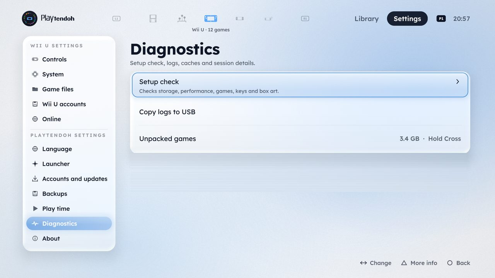

# Getting help

If [Troubleshooting](troubleshooting.md) didn't solve it, ask. A question with the right details gets an
answer fast; one without them gets asked for them first.

## 1. Get your details {#details}

Open **Settings > Diagnostics**. Its lines under the rows give what almost every question needs:

- Playtendoh's **version** (also on **Settings > About**)
- your PS5's **firmware**
- what your **HEN** gave the app: the `HEN`, `JIT` and `/data` lines ([reading them](jailbreak.md#check))

Add which **HEN** you use, and its version.

## 2. Copy the logs {#logs}

Right after the problem, plug a USB drive into the PS5 and choose **Settings > Diagnostics > Copy logs to
USB**. It puts the logs and settings in a dated `PS5-ECAM-logs-...` folder on the drive.

Do it soon: the app keeps only the last five sessions' logs. When a game crashed, the next start says so
once, so you know to copy them.

## 3. Ask {#ask}

- **On the [Discord](https://discord.gg/grrqkv4xWw)**, in the support channel: what you did, what happened,
  your details from step 1, and the logs from step 2.
- **On GitHub**, with the [bug report form](https://github.com/premohq/PlayTendoh/issues/new/choose): it
  asks for the same things.

Check the [compatibility list](../compatibility.html) first for a game that doesn't run: it shows how each
game runs on other people's consoles.

## Reports help too {#reports}

With **Settings > Accounts and updates > Send reports** on, Playtendoh sends a short report each time a
game ends: the game, how it ended, its settings, the PS5's firmware and model, and the last lines of the
logs, with nothing about you. That's how problems get found and fixed without anyone having to ask.
[Every field a report has](https://github.com/premohq/PlayTendoh/blob/Playtendoh/docs/REPORTS.md).

> [!CAUTION]
> **Never post keys, firmware, BIOS files or games**, in the Discord or on GitHub, and never ask for them.
