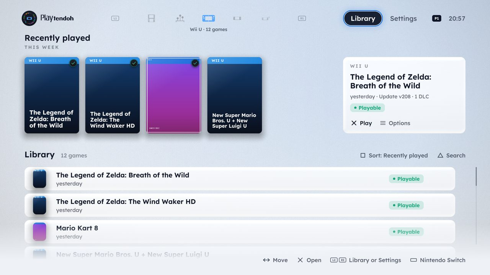

# Set up Playtendoh, start to finish

This guide takes you from a PS5 to playing your own Nintendo games in Playtendoh, one step at a time.
It covers every PS5 that can run homebrew (the original, the Slim and the Pro, with a disc drive or
without) and every HEN, and it's written for **Playtendoh 6.0**.

> [!IMPORTANT]
> **Read each page all the way through before you do what it says, and do the steps in order.** Almost
> every problem people bring to the Discord is a step that was skipped: the app's folder one level too
> deep, a HEN setting that wasn't turned on, keys from a different console version than the firmware.

## What you'll have at the end {#what-youll-have}

- Your PS5 running homebrew, with a HEN loaded after each restart.
- Playtendoh on the home screen, with the systems you want shown in its bar.
- Your games in the right folders, with the keys, firmware or BIOS files the systems that need them.
- A Setup check in the app that says everything is ready, and you knowing where to look when it isn't.

Set aside about an hour the first time, most of it copying your games.

## What Playtendoh is {#what-it-is}

Playtendoh is a homebrew app for a jailbroken PS5 that plays twenty-one Nintendo systems behind one
launcher made for the TV and the DualSense:

| System | Plays on |
|---|---|
| Wii U | Cemu |
| Nintendo 3DS | Azahar |
| Nintendo DS | melonDS |
| Nintendo Switch | Eden (ProsperoEden's PS5 port) |
| Switch 2 *(experimental)* | EglantinePS5, on Lichii |
| GameCube and Wii | Dolphin (Porpoise X) |
| N64, NES, SNES, the Game Boys, Virtual Boy and more | libretro cores, built into the app |

Every system gets the same Library, the same settings and the same in-game menu. Playtendoh plays
games, keys and system files **you dump from consoles and games you own**. It includes none of them,
and this guide never links to any.

## The steps {#steps}

1. [**Get started**](get-started.md): find your firmware, see which way in it has, and gather what
   you'll need.
2. [**Jailbreak and HEN**](jailbreak.md): get the PS5 running homebrew, and let Playtendoh in.
3. [**Install Playtendoh**](install.md): copy the app to the console and put it on the home screen.
4. [**The first start**](setup-check.md): the app's five questions, turning on the systems you want,
   and the Setup check that says what's left.
5. [**Where your files go**](files.md): every system's folders, and the ways to copy files over.

Then the **Playing** pages: [Using Playtendoh](using.md) (the launcher, the in-game menu, saves,
cheats and achievements), and a page for each system with what it needs and every setting it has:
[Wii U](wii-u.md), [3DS](3ds.md), [DS](ds.md), [Switch](switch.md), [Switch 2](switch-2.md),
[GameCube and Wii](gamecube-wii.md) and [the classics](classics.md).

## When something's wrong {#help}

- **The Setup check** in the app names what's missing, with a QR code to the right page of this guide:
  **Settings > Diagnostics > Setup check**.
- [**Troubleshooting**](troubleshooting.md) has the problems people hit most, each with its fix.
- [**Getting help**](help.md) says what to send when you ask, so you get an answer the first time.
- [**Updating**](updating.md) covers new versions, and coming from PS5CEMU-HAR or PS5-ECAM.

> [!WARNING]
> Running homebrew needs a jailbroken console. That may void its warranty and breaks the PlayStation
> Network's terms. You do it at your own risk.
