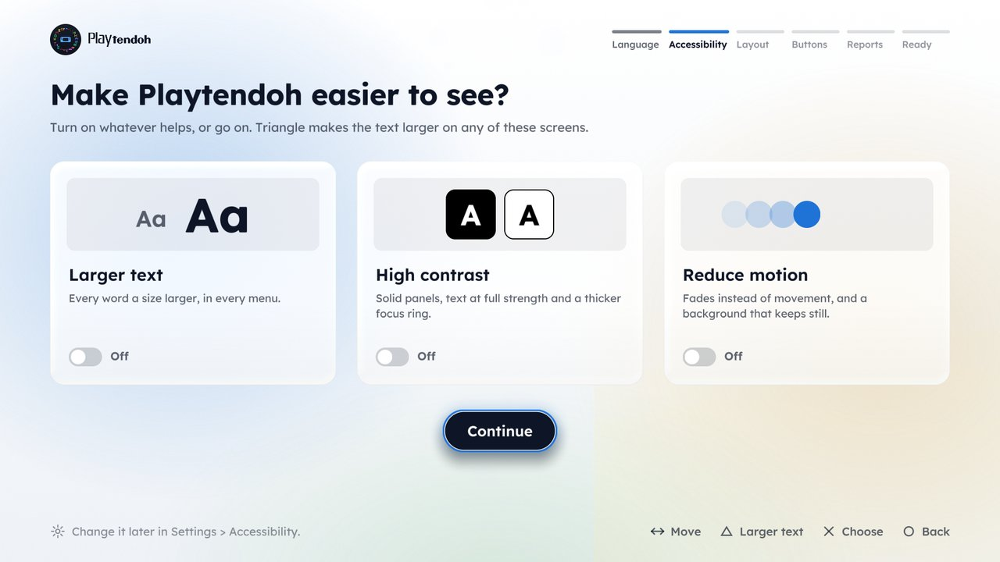
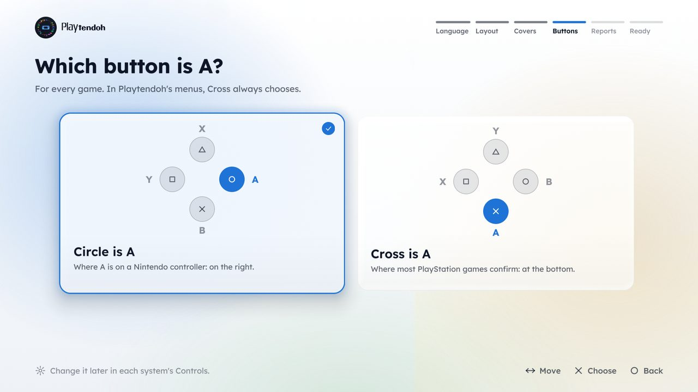
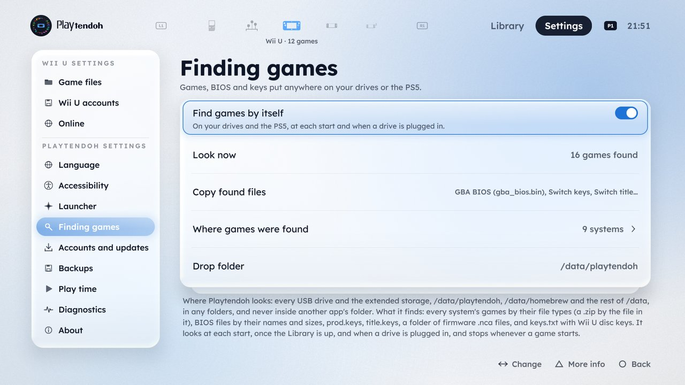
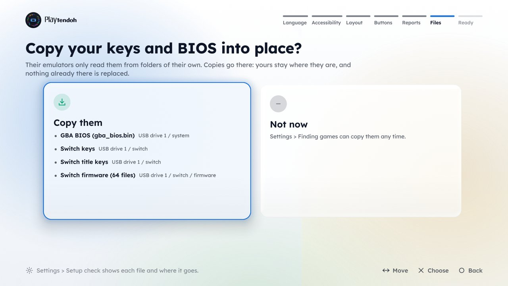
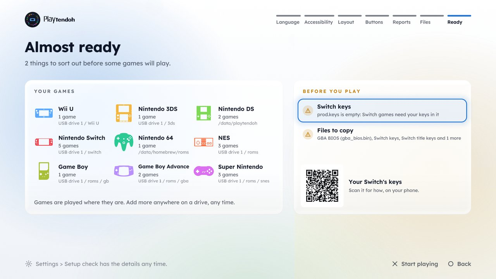
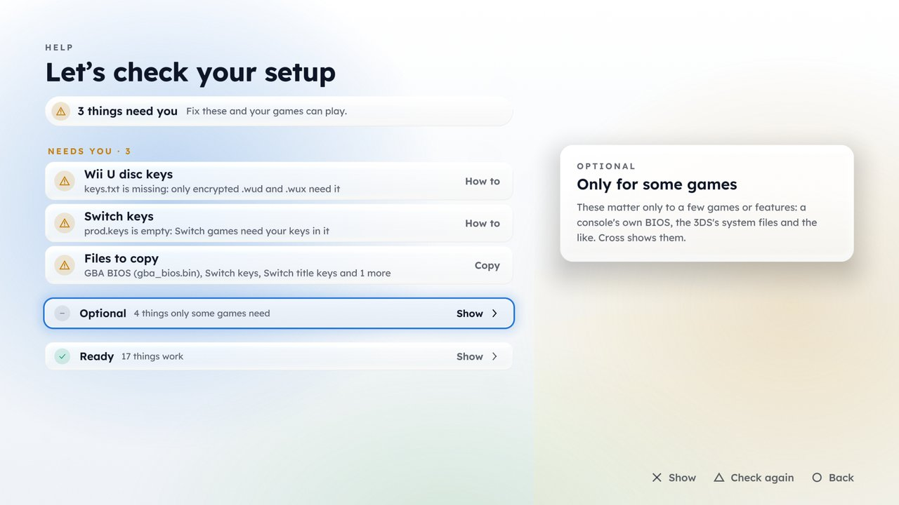

# The first start and the Setup check

The first time Playtendoh starts, it asks a few questions, one a screen. While you answer them it looks for
your games, BIOS files and keys on your USB drives and the PS5's storage, so you don't have to put them in
any particular place. Then it shows what it found. Cross chooses and goes on, Circle goes back a step, and
the bar at the top right says how far along you are. Every answer can be changed later, and **Settings >
Launcher > Make it yours** runs the questions again.

## 1. Which language? {#language}

Playtendoh speaks your PS5's language, marked **PS5**. Pick another if you like; **Settings > Language**
changes it later. 31 languages are in. **Triangle** makes the text larger right away, on this screen and the
next.

## 2. Make Playtendoh easier to see? {#accessibility}

| Choice | What it does |
|---|---|
| **Larger text** | Every word a size larger, in every menu. |
| **High contrast** | Solid panels instead of glass, all text at full strength and a thicker focus ring. |
| **Reduce motion** | Short fades instead of movement, and a background that keeps still. |

Cross turns the selected one on or off and you see it at once. **Continue**, below them, is selected when the
screen opens, so one press goes on. **Settings > Accessibility** changes them later, with **Hold to
confirm** (how long Cross is held for actions that can't be undone).

## 3. How do you want to browse your games? {#layout}

| Layout | What it is |
|---|---|
| **Classic** | One console at a time. L1 and R1 switch consoles. Recently played on top, all games below. The easiest to start with. |
| **Orbit** | Turn the dial to pick a console. The centre shows what you played lately on any console. |
| **EmulationStation** | ES-DE's own menus and themes, downloaded when you finish (about 850 MB). Games still play in Playtendoh. |

Your games, saves and settings are the same whichever you pick. **Settings > Launcher > Layout** changes
it later. With EmulationStation, hold **L1** while Playtendoh starts to get its own launcher instead.
Covers are flat pictures to start with; **Settings > Launcher > 3D box art** shows them as boxes.

## 4. Which button is A? {#buttons}

This is for the **games**: **Circle is A** puts A where it is on a Nintendo controller (on the right),
**Cross is A** where most PlayStation games confirm (at the bottom). In Playtendoh's own menus, Cross
always chooses. Each system's **Settings > Controls** changes it later.

## 5. Help Playtendoh get better? {#reports}

When a game ends, Playtendoh can send a short report on how it ran: the game, how it ended and its
settings, with the PS5's firmware and model. **Nothing is sent while you play**, and a report never has
your PSN name or ID, your console's serial or addresses, your accounts, folders, saves or game list.
The reports make the [compatibility list](../compatibility.html) and help fix what fails.
**Settings > Accounts and updates > Send reports** turns it on or off later.

## 6. Finding your games {#finding-games}

Playtendoh looks through, in any folders:

- every **USB drive** and the **extended storage** plugged in;
- **`/data/playtendoh`**, a folder made for you: put anything there;
- **`/data/homebrew`** and the rest of **`/data`**, every system's own folder included.

It finds every system's games by their file types (and, where it's quick, by what is inside them: a `.3ds`
that is really a 3D model is left out), BIOS files by their names and sizes, the Switch's `prod.keys`,
`title.keys` and firmware (a folder of `.nca` files), and the Wii U's `keys.txt`.

- **Games are played where they are.** Nothing is moved, renamed or deleted. A system's Library looks in
  its own folder and in each place its games were found.
- **Every system it finds games for is turned on** in the bar, unless you hid it yourself.
- **A folder you chose** in a system's **Settings > Game files** is used as it is: Playtendoh adds nothing to
  that system.

If the look is still going when you finish the questions, a screen shows where it's looking; Cross goes on
without waiting, and what it finds shows up in the Library as it ends. Playtendoh looks again at every start
and when you plug in a drive (a sign beside the clock shows while it looks).

**Settings > Finding games** turns that off, looks again whenever you ask (**Look now**), lists where each
system's games were found, and copies what it found (**Copy found files**). The Setup check's **Find games
and files** row looks again too.

## 7. Copy your keys and BIOS into place? {#files-to-copy}

BIOS files, keys and firmware are different from games: each emulator reads them from one folder of its
own. When Playtendoh finds one that isn't there yet, it asks before copying it there:

- **Copy them** makes a copy in the emulator's folder ([Where your files go](files.md) lists them). Your file
  stays where it is, and **a file already there is never replaced**.
- **Not now** leaves them; **Settings > Finding games > Copy found files**, or the Setup check's **Files to
  copy** row, copies them later.

The Switch's keys and firmware are copied for the Switch 2 side too. When there are several, the newest keys
are taken, with the firmware found nearest to them: keys and firmware from the same console and the same
system version work best together ([error 59](troubleshooting.md#switch-error-59)).

## 8. You're ready to play, or almost {#ready}

The last screen asks nothing. It shows each console's games, how many and where they were found, and
anything that stands in the way of playing them, with a QR code to the page of this guide that fixes it.
Cross starts playing.

## Showing and hiding systems {#systems}

Every system Playtendoh finds games for is shown in the bar. Out of the box, before any games are found,
the bar shows the Wii U, Switch, Switch 2, DS and 3DS; the GameCube, the Wii and every classic system (N64,
NES, SNES, the Game Boys and the rest) appear as soon as their games are found. **Settings > Launcher >
Systems** shows or hides any of them.

Each system has a switch. A hidden system keeps its games and settings, at least one stays on, and a system
you hid stays hidden whatever games are found for it.

## The Setup check {#setup-check}

The Setup check answers "why doesn't it work?" in one screen. It opens by itself when a start finds
something wrong with storage or game speed, and any time from **Settings > Diagnostics > Setup check**.

It shows first what **needs you** (amber), a row each: something to fix before those games can play. Below
them, two rows hold the rest, folded so the screen stays short:

- **Optional** (grey): what only some games need, a console's own BIOS, the 3DS's system files and the like.
- **Ready** (green): what works, your games among it.

Cross on either opens it, and again folds it.

Move to a row and the panel beside it says what it means and what to do, with a **QR code**: scan it with
your phone and it opens the page of this guide about that row. **Cross** does the row's action (look for
games, copy files, choose a folder, see how), **Triangle** checks everything again after you've copied
files, and **Circle** goes on to the Library.

## Every row, and what to do {#rows}

| Row | What to do when it isn't ready |
|---|---|
| **Storage** | `/data` can't be reached. [Let Playtendoh in](jailbreak.md#app-jailbreak) through your HEN, or run an ELF loader on port 9021, then start the app again. |
| **Game speed** | Wii U games would run slowly. See [game speed](jailbreak.md#game-speed). |
| **Find games and files** | How many games the last look found. Cross looks again on the drives and in `/data` ([finding your games](#finding-games)). |
| **Files to copy** | BIOS files, keys or firmware were found and aren't in place yet. Cross copies them; the panel lists each one, from where and to where ([copying](#files-to-copy)). |
| ***Console* games** | How many games that console has, and where most of them are. None yet is optional: put them anywhere on a USB drive or in `/data/playtendoh`, or press Cross to choose a folder. "Cannot be read" is a folder you chose that isn't there. |
| **Wii U disc keys** | Only encrypted `.wud` and `.wux` need them. It says how many keys `keys.txt` holds; "no keys" on a file you filled before means it was emptied: put your copy back ([disc keys](wii-u.md#disc-keys)). |
| **3DS system files** | Optional: for the 3DS Home Menu and a few games ([system files](3ds.md#system-files)). |
| **DS BIOS** | Optional: most games run on the built-in one ([DS BIOS](ds.md#bios)). |
| ***Console* BIOS** | The Famicom Disk System and the Satellaview need theirs; for the others it's optional ([the classics' BIOS](classics.md#bios)). |
| **Switch keys**, **Switch firmware** | Switch games need both, from your own Switch. "prod.keys is empty" means the file is there with nothing in it ([keys and firmware](switch.md#keys-and-firmware)). |
| **Switch 2 keys**, **Switch 2 firmware** | The same for the Switch 2 side ([its keys and firmware](switch-2.md#keys-and-firmware)). |
| **Box art** | Covers download from GameTDB ([box art](#box-art), below). |
| **Another copy of Playtendoh** | A second copy of the app is on the console, and the home screen may start it. It says which version and where: delete the one you don't use ([an old version comes back](troubleshooting.md#old-version)). |

## Box art {#box-art}

The first time a game shows up, Playtendoh downloads its cover from [GameTDB](https://www.gametdb.com/)
in the background: by the ID on the game's box, a Switch game's by its name, and the classics' from
libretro's thumbnails by the game file's name. Without an internet connection, or when GameTDB doesn't
answer, the Library shows the game's own icon and tries again next time.

Each system's **Settings > Online** has the box art rows: **Box art from GameTDB** (on or off),
**Download missing box art**, and **Download all box art again** (hold Cross) for covers that came out
wrong. On the Switch side, **Switch covers** picks GameTDB's box art or each game's own icon. Beside a
Switch game, a picture with the game's name (`Game.png` or `Game.jpg`) is its cover instead.
