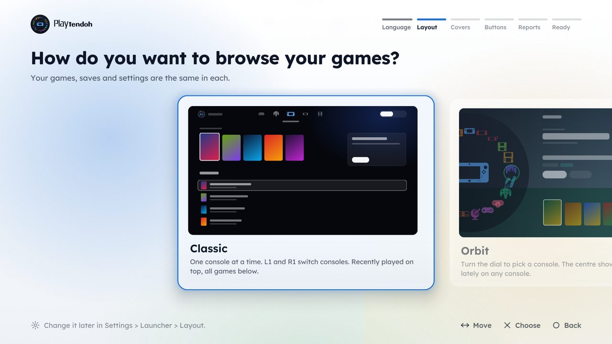
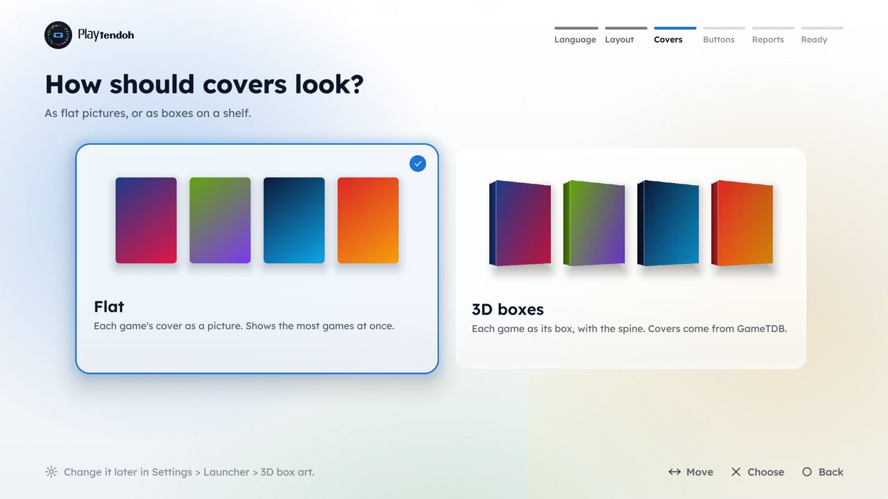
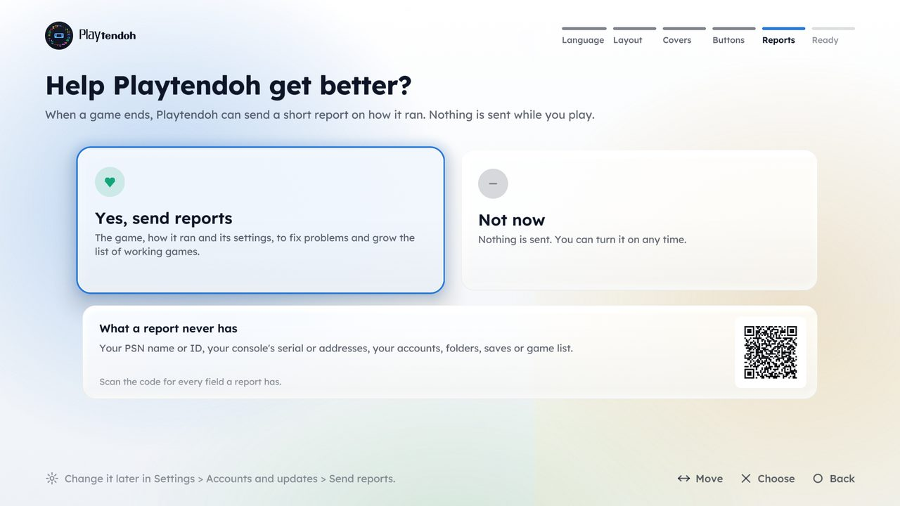
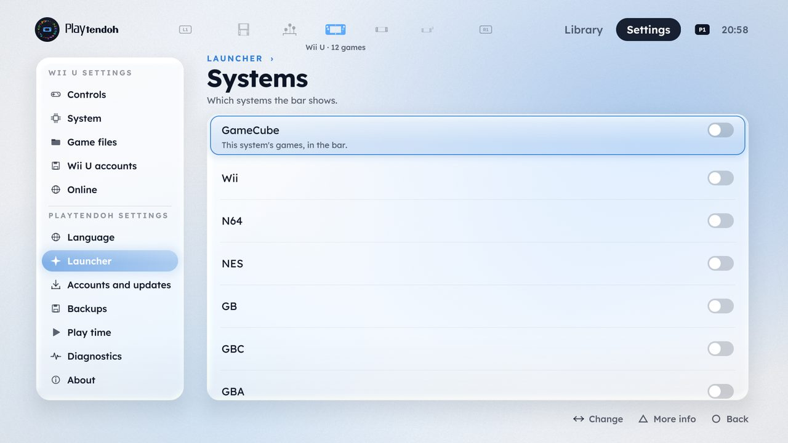

# The first start and the Setup check

The first time Playtendoh starts, it asks five questions, one a screen, then shows what's ready. Cross
chooses and goes on, Circle goes back a step, and the bar at the top right says how far along you are.
Every answer can be changed later, and **Settings > Launcher > Make it yours** runs the questions again.

## 1. Which language? {#language}

Playtendoh speaks your PS5's language, marked **PS5**. Pick another if you like; **Settings > Language**
changes it later. 31 languages are in.

## 2. How do you want to browse your games? {#layout}

| Layout | What it is |
|---|---|
| **Classic** | One console at a time. L1 and R1 switch consoles. Recently played on top, all games below. The easiest to start with. |
| **Orbit** | Turn the dial to pick a console. The centre shows what you played lately on any console. |
| **EmulationStation** | ES-DE's own menus and themes, downloaded when you finish (about 850 MB). Games still play in Playtendoh. |

Your games, saves and settings are the same whichever you pick. **Settings > Launcher > Layout** changes
it later. With EmulationStation, hold **L1** while Playtendoh starts to get its own launcher instead.

## 3. How should covers look? {#covers}

**Flat** shows each cover as a picture, and the most games at once. **3D boxes** shows each game as its
box, spine and all. Covers come from GameTDB either way. **Settings > Launcher > 3D box art** changes it.

## 4. Which button is A? {#buttons}

This is for the **games**: **Circle is A** puts A where it is on a Nintendo controller (on the right),
**Cross is A** where most PlayStation games confirm (at the bottom). In Playtendoh's own menus, Cross
always chooses. Each system's **Settings > Controls** changes it later.

## 5. Help Playtendoh get better? {#reports}

When a game ends, Playtendoh can send a short report on how it ran: the game, how it ended and its
settings, with the PS5's firmware and model. **Nothing is sent while you play**, and a report never has
your PSN name or ID, your console's serial or addresses, your accounts, folders, saves or game list.
The reports make the [compatibility list](../compatibility.html) and help fix what fails.
**Settings > Accounts and updates > Send reports** turns it on or off later.

## 6. You're ready to play, or almost {#ready}

The last screen asks nothing. It shows the games found on each console, and anything that stands in the
way of playing them, with a QR code to the page of this guide that fixes it. Cross starts playing.

## 7. Turn on the systems you want {#systems}

> [!IMPORTANT]
> **Out of the box, the bar shows the Wii U, Switch, Switch 2, DS and 3DS only.** The GameCube, the Wii and
> every classic system (N64, NES, SNES, the Game Boys and the rest) start hidden. Turn on the ones you
> want: **Settings > Launcher > Systems**.

Each system has a switch. A hidden system keeps its games and settings, and at least one stays on.

## The Setup check {#setup-check}

The Setup check answers "why doesn't it work?" in one screen. It opens by itself when a start finds
something wrong with storage or game speed, and any time from **Settings > Diagnostics > Setup check**.

Each row is one thing Playtendoh needs, grouped:

- **Needs you** (amber): something to fix before those games can play.
- **Optional** (grey): only some games need it.
- **Ready** (green): nothing to do.

Move to a row and the panel beside it says what it means and what to do, with a **QR code**: scan it with
your phone and it opens the page of this guide about that row. **Cross** does the row's action (choose a
folder, see how), **Triangle** checks everything again after you've copied files, and **Circle** goes on
to the Library.

## Every row, and what to do {#rows}

| Row | What to do when it isn't ready |
|---|---|
| **Storage** | `/data` can't be reached. [Let Playtendoh in](jailbreak.md#app-jailbreak) through your HEN, or run an ELF loader on port 9021, then start the app again. |
| **Game speed** | Wii U games would run slowly. See [game speed](jailbreak.md#game-speed). |
| ***Console* games** | No games found yet in that console's folder. Copy them in, or press Cross to choose another folder. [Where your files go](files.md) has every folder. |
| **Wii U disc keys** | Only encrypted `.wud` and `.wux` need them. It says how many keys `keys.txt` holds; "no keys" on a file you filled before means it was emptied: put your copy back ([disc keys](wii-u.md#disc-keys)). |
| **3DS system files** | Optional: for the 3DS Home Menu and a few games ([system files](3ds.md#system-files)). |
| **DS BIOS** | Optional: most games run on the built-in one ([DS BIOS](ds.md#bios)). |
| ***Console* BIOS** | The Famicom Disk System and the Satellaview need theirs; for the others it's optional ([the classics' BIOS](classics.md#bios)). |
| **Switch keys**, **Switch firmware** | Switch games need both, from your own Switch. "prod.keys is empty" means the file is there with nothing in it ([keys and firmware](switch.md#keys-and-firmware)). |
| **Switch 2 keys**, **Switch 2 firmware** | The same for the Switch 2 side ([its keys and firmware](switch-2.md#keys-and-firmware)). |
| **Box art** | Covers download from GameTDB ([box art](#box-art), below). |
| **System folders** | Where each system's files are kept ([Where your files go](files.md)). |
| **Another copy of Playtendoh** | A second copy of the app is on the console, and the home screen may start it. It says which version and where: delete the one you don't use ([an old version comes back](troubleshooting.md#old-version)). |

## Box art {#box-art}

The first time a game shows up, Playtendoh downloads its cover from [GameTDB](https://www.gametdb.com/)
in the background: by the ID on the game's box, a Switch game's by its name, and the classics' from
libretro's thumbnails by the game file's name. Without an internet connection, or when GameTDB doesn't
answer, the Library shows the game's own icon and tries again next time.

Each system's **Settings > Online** has the box art rows: **Box art from GameTDB** (on or off),
**Download missing box art**, and **Download all box art again** (hold Cross) for covers that came out
wrong. On the Switch side, **Switch covers** picks GameTDB's box art or each game's own icon. Beside a
Switch game, a picture with the game's name (`Game.png` or `Game.jpg`) is its cover instead.
