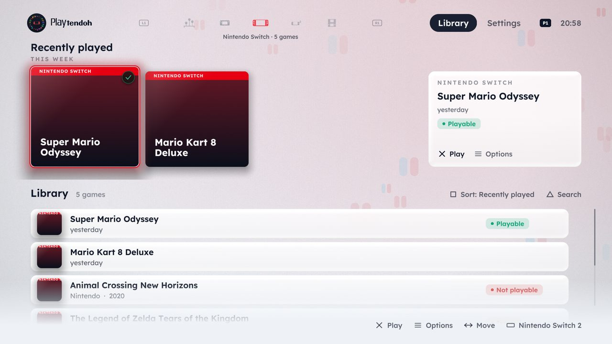
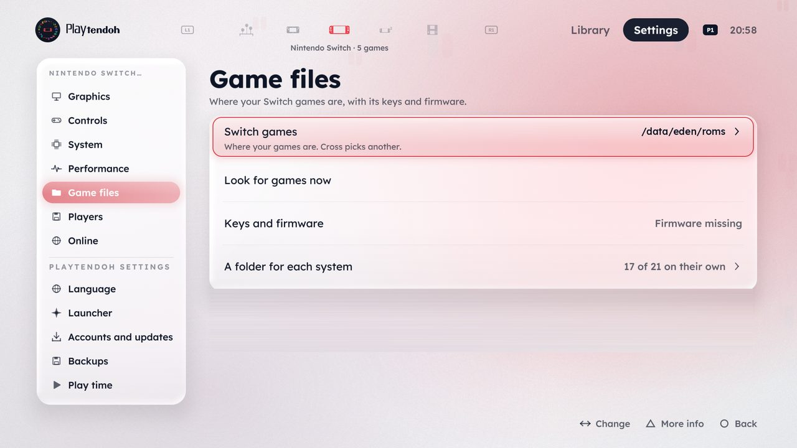

# Nintendo Switch

The Switch side plays on [Eden](https://github.com/eden-emu/mirror), in Sword's PS5 port,
[ProsperoEden](https://github.com/Swordpdf/ProsperoEden). It's a program of its own inside Playtendoh, but
you never see its screens: Playtendoh's loading screen, in-game menu and Library are the same as every
other system's.

## What you need {#what-you-need}

- **Your games** (`.nsp` or `.xci`), dumped from your own Switch and cartridges.
- **Your Switch's keys:** `prod.keys`, and `title.keys`.
- **Your Switch's firmware:** its `.nca` files.

All three come from **your own Switch**. Playtendoh includes none, and the Switch side reads no game
without the keys.

## Your games {#games}

Put them in **`/data/eden/roms`**, or choose any folder in the Switch side's **Settings > Game files** (its
first row), on the PS5 or a drive. Switch games can't play from a network share.

```text
/data/eden/roms/
├── Game [0100000000010000].nsp        a game on its own
└── Another Game/                      or a game in a folder of its own,
    ├── Another Game.xci               with its update and DLC beside it
    └── Another Game [Update].nsp
```

A title ID in brackets in a file's name, as dumps have it, keeps the game's settings and its place in
Recently played whatever you call the file. With your keys, the Library reads each game's own name and
icon from its file.



## Keys and firmware {#keys-and-firmware}

```text
/data/eden/
├── keys/
│   ├── prod.keys
│   └── title.keys
└── firmware/          every .nca file of your Switch's firmware
```



> [!IMPORTANT]
> **Keys and firmware must be from the same Switch, at the same system version.** Keys from an older version
> than the firmware cause **error 59** and **"Loader status 28"**: dump both again from your Switch, at the
> same time. Playtendoh says so when a game can't start for want of newer keys.

**Settings > Game files > Keys and firmware**, and the Setup check's **Switch keys** and **Switch
firmware** rows, say what's found. "prod.keys is empty" means the file is there with nothing in it: copy
yours again. You can also send keys and firmware from a phone ([how](files.md#from-a-phone)).

A standalone ProsperoEden's files in `/data/prosperoeden` are used while `/data/eden` has no keys.

## Updates and DLC {#updates}

No installing needed. Put an update or DLC:

- in the game's own folder, or beside the game, in any games folder (a USB drive's too);
- or in **`/data/eden/updates`** (or a `/data/eden/dlc` you make).

The title ID in a dump's name says whose it is. A game's page shows the update's version and how many DLC
it found (`Update v1.2.0`, `2 DLC`), as the game will run.

## Mods and cheats {#mods}

Put them in **`/data/eden/mods`**, or in the game's own folder, laid out as Eden on a computer has them.
A game's **Game settings > Mods** and **Cheats** list them, each on or off, with a switch for all of
them. Choices apply from the game's next start; the files are never moved.

## Settings {#settings}

| Page | What's there |
|---|---|
| **Graphics** | Resolution (0.5x to 4x of the game's own), upscaling to 4K (FSR 1 among them), ASTC textures, **anti-aliasing**, **frame generation**, **picture effects** (Eden's ReShade looks), the performance overlay |
| **Controls** | The DualSense as the Switch, the sticks' deadzone, vibration |
| **System** | **Docked or handheld**, the **controller type** (automatic, Pro Controller, handheld, Joy-Con pair or one), the **speed limit**, language and sound |
| **Performance** | Speed, accuracy and memory |
| **Game files** | The games folder, Look for games now, **Keys and firmware** |
| **Players** | Eden's players, each with their own saves |
| **Online** | Box art, **Switch covers** (GameTDB's or each game's icon), **Multiplayer** |

**Frame generation** shows a game at 30 fps at 60. It uses Lossless Scaling's when your own copy of its
`Lossless.dll` (from the Lossless Scaling you bought) is in `/data/eden/user/lossless`, else MihawkGen's.

## In a game {#in-game}

- **Touchpad click + Options** opens Playtendoh's in-game menu: graphics, speed limit, volume, controls,
  **amiibo** (from `/data/ps5cemu/amiibo`), the multiplayer room, and Quit to the library. The game keeps
  running behind it.
- **A game that stops answering**, its menu too: hold **L1** and click the touchpad's left side. That
  leaves the game, and if it won't stop, Playtendoh starts again by itself within half a minute.
- A game that won't start, stops with an error or crashes comes back to the Library, which says why.

## Multiplayer {#multiplayer}

**Settings > Online > Multiplayer**: choose a public room (the featured ones first) or a private one by its
address, port (usually 24872) and password, and a nickname. Each Switch game then joins it as it starts;
choose Local Wireless in the game to play with the others in the room.

## Saves {#saves}

Saves are in `/data/eden/user/nand/user/save`, and **Settings > Backups** takes them with every other
system's. A game's **Saves** page backs up and restores that game's alone, and moves a save between
consoles:

- **To a USB drive:** into `PS5-ECAM-exports`, as folders another emulator can take.
- **From a USB drive:** from `PS5-ECAM-imports/<title ID>`, or a copy of Ryujinx's folder in `Ryujinx`.
- **From standalone ProsperoEden** on the same PS5: **Take a save** lists its players by name.

Every file is checked before a save is replaced, and the one it replaces is kept in
`/data/eden/save-transfer-recovery`.

## Known problems {#known-problems}

These are being worked on. Until then:

- **Mario Kart 8 Deluxe goes back to its loading screen** after the title's voice line, over and over. No
  fix yet; logs from it help ([Getting help](help.md)).
- **Games on a USB drive or a folder of your own go to a black screen** on some consoles, where the same
  file plays from the internal storage. Play from `/data/eden/roms` for now.
- **After rest mode, no game starts.** Close Playtendoh and start it again.
- **With firmware 23 and its keys, games are counted but not listed.** Being looked at.
