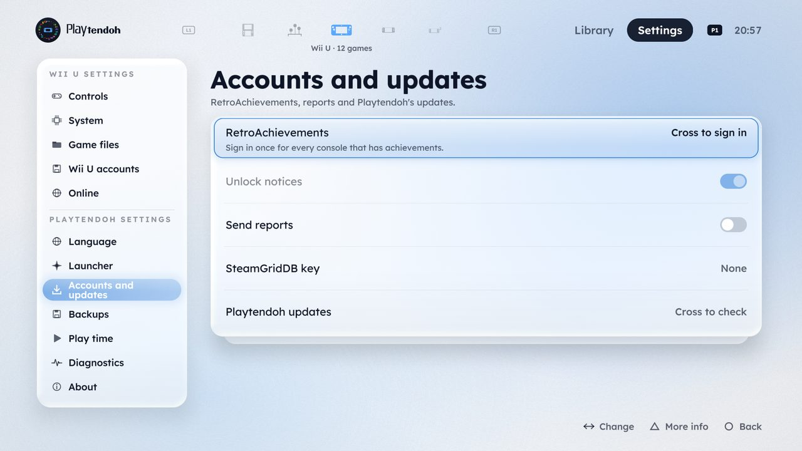

# Updating

Playtendoh updates itself, and an update keeps your games, saves and settings: none of them are in the
app's own folder.

## From inside the app {#in-app}

When Playtendoh starts, it asks GitHub whether a newer release is out, and if one is, it offers it:

1. Choose **Update now**. It downloads the release (Circle stops it) and checks it against the release's
   checksum.
2. It puts the new files in place of the old ones and starts again, on the new version.
3. If the PS5 doesn't start it again by itself, close Playtendoh and start it from the home screen.

**Skip this version** stops it asking about that release at start. **Settings > Accounts and updates >
Playtendoh updates** checks again at any time.

After an update, Playtendoh opens once on what the new version brings.

## Going back {#going-back}

An update keeps the version it replaced until the next update. **Settings > Accounts and updates > Go back
to** (hold Cross) puts it back and starts it, and the newer release isn't offered at start again.

## By hand {#by-hand}

1. Download the new ZIP and unzip it ([Install](install.md#download)).
2. Copy its `PPSA99360` folder over the one on the console, replacing the files.
3. Start Playtendoh.

Copy over **the copy you start**: if there are two, the home screen may start the old one
([keep one](install.md#one-copy)).

## From PS5CEMU-HAR, PS5-ECAM or an older Playtendoh {#from-older}

Playtendoh was called PS5CEMU-HAR, then PS5-ECAM. The title ID has always been `PPSA99360`, so updating
from any of them is the same as above, and nothing moves:

- An install from before keeps all its files in `/data/ps5cemu`, and goes on working there. A start then
  offers to give each system its own folder (**Reorganize**, or **Later**); see
  [an install from before](files.md#older-install).
- **Updating to 6.0:** after the update, turn on the new systems you want (GameCube, Wii and the
  classics) in **Settings > Launcher > Systems**, and look at **Settings > Launcher > Make it yours** for
  6.0's layouts and covers.
- Older versions' updaters (up to 4.0.1) still find the new release.
