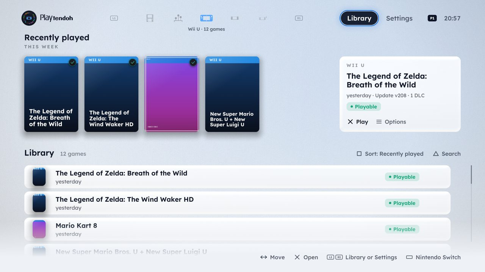
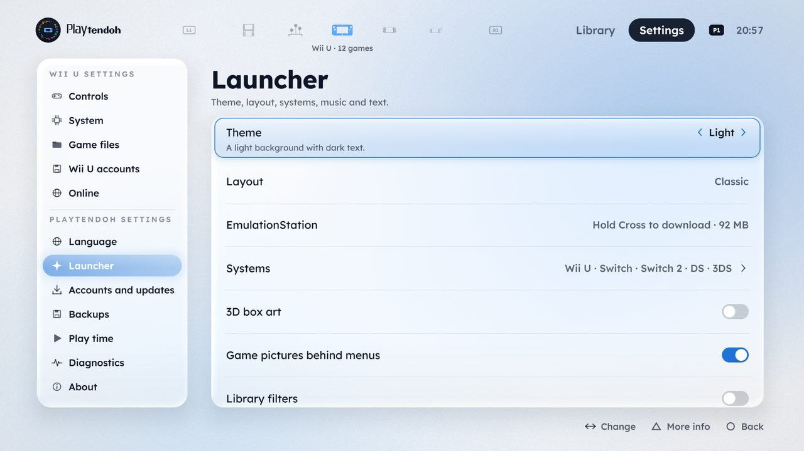
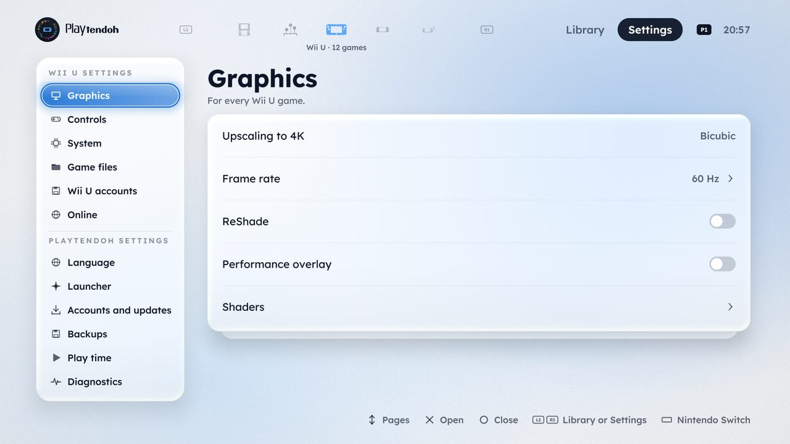

# Using Playtendoh

Every system in Playtendoh works the same way: the same Library, the same Settings, the same in-game menu.
This page is how. Each system's own page has what's special about it.

## Getting around {#buttons}

| Button | In the launcher |
|---|---|
| **L1 / R1** | The previous or next system (after the last one: the Timeline) |
| **L2 / R2** | The Library, or Settings |
| **Touchpad click** | The next system |
| **R3** | Orbit: back to the dial's middle, what you played last |
| **Cross** | Play the game, or open what's selected |
| **Options** | A game's options: its page, its own settings, favourite, hide, home screen tile |
| **Square** | Sort (Library); back to Default (a game's settings) |
| **Triangle** | Search (Library); more about the selected setting (Settings) |
| **Circle** | Back |

The app opens on the system a game came back from, or the one you used last, with the game you played
last selected.

## The layouts and the Timeline {#layouts}

- **Classic:** one system at a time, chosen from a carousel. Recently played on top, every game below.
- **Orbit:** the logo is a dial L1 and R1 turn; its middle is what you played last on every system, and
  the game you're on fills the background.
- **EmulationStation (ES-DE):** its own menus, themes and scraper, downloaded only if you pick it. Its
  games still play in Playtendoh, with the same emulators, settings and saves. Hold **L1** as Playtendoh
  starts to get its own launcher instead.
- **The Timeline,** a stop after the last system in Classic and Orbit: every system's games on one shelf,
  oldest to newest, each as the disc or cartridge it came on. A game whose manual Nintendo keeps online
  has a QR code to it.

**Settings > Launcher > Layout** switches between them.

## The Library {#library}

- **Sort** (Square): change the list's order; its last choice, **Surprise me**, picks a game at random.
- **Search** (Triangle): type part of a game's name.
- **Filters:** **Settings > Launcher > Library filters** adds a row above the list (All, Recently added,
  Favourites...).
- **Favourite** or **Hide from the Library**, in a game's Options menu. A hidden game still turns up in
  Search.
- **How games run:** each game's badge (Playable, Issues, Not playable) from the
  [compatibility list](../compatibility.html). **Settings > Launcher > How games run** hides them.

## A game's own settings {#game-settings}

**Options** on a game, then **Game settings**: the same pages as the system's Settings, for that game
alone. Each value shows **Default** (the system's) until you change it, and **Square** puts it back.
Changes you make in the in-game menu are kept as that game's.

## The in-game menu {#in-game-menu}

In any game, **touchpad click + Options** opens Playtendoh's in-game menu, on every system:

- **Quick actions** along the top (Resume, save and load state, screens, graphic packs, amiibo... as the
  system has them).
- **Picture, screens, sound and controls**, changed while you play and kept for your next games.
- **Buttons:** which DualSense button presses each of the console's buttons. Cross on a button, then
  press the one you want for it; a live controller test above the list shows each press.
- **Quit to the library:** hold Cross until the ring fills. Unsaved progress is lost.

> [!TIP]
> **A Switch or Switch 2 game that froze, its menu too:** hold **L1** and click the touchpad (its left side,
> on the Switch). That leaves the game, and if it won't stop, Playtendoh starts again by itself within half
> a minute. On the other systems, close Playtendoh from the PS button's menu.

## Saves, save states and backups {#saves}

- **The games' own saves** work as on the console, kept in each system's folder.
- **Save states** (3DS, DS and the classics): in the in-game menu. On the 3DS and DS there are five slots
  a game, touchpad click + Square saves to the chosen one and touchpad click + Triangle (held) loads it.
  After a load, **Undo the last load** puts the game back as it was, for a wrong slot loaded by mistake.
- **Resume where you left off** (3DS, DS): Quit to the library saves a state first, and the game's Options
  menu then has **Resume where you left off**.
- **Backups:** **Settings > Backups > Back up to USB** copies every system's saves, save states and Wii U
  accounts to a USB drive; **Restore from USB** puts one back. Do it before you change anything big.

## Achievements and cheats {#achievements}

- **RetroAchievements:** **Settings > Accounts and updates > RetroAchievements**, sign in once. It covers
  the DS, GameCube, Wii, N64, SNES, NES, Game Boys, Virtual Boy and Pokémon mini. **Unlock notices** shows
  unlocks as PS5 notifications.
- **Cheats:** on the classics, a game's **Game settings > Cheats** gets that game's cheats and turns each
  on or off. The 3DS, Switch and GameCube/Wii have their own ([3DS](3ds.md#cheats), [Switch](switch.md#mods),
  [GameCube and Wii](gamecube-wii.md#per-game)).
- **Amiibo:** put your own amiibo dumps (`.bin`) in `/data/ps5cemu/amiibo`, then choose one in the in-game
  menu when a Wii U, 3DS or Switch game asks for it.

## Make it yours {#make-it-yours}

- **Theme:** **Settings > Launcher > Theme**: Light, Link Jack, Classic, Eden or Midnight (true black, for
  OLED TVs), or your own JSON in `/data/ps5cemu/themes`.
- **Music and menu sounds:** **Settings > Launcher**: the original theme, or your own MP3 or WAV files from
  `/data/ps5cemu/music`.
- **Larger text, High contrast, Reduce motion** and **Hold to confirm** are on **Settings > Launcher** too.
- **Home screen tiles:** **Add to home screen** in a game's Options menu makes it a tile on the PS5's home
  screen that starts the game straight away (it needs elfldr on port 9021).
- **Play time:** **Settings > Play time**: each system's hours and your ten most played games.

## Where Settings are {#settings}

**R2** opens Settings. Down the left are the system's own pages first (Graphics, Controls, System, Game
files, Online, and what that system has besides), then **Playtendoh's settings**, the same on every
system:

| Page | What's there |
|---|---|
| **Language** | The menus' language |
| **Launcher** | Theme, layout, which systems the bar shows, covers, filters, badges, music, text size, Make it yours |
| **Accounts and updates** | RetroAchievements, reports, a SteamGridDB key, and Playtendoh's updates |
| **Backups** | Every system's saves, to a USB drive and back |
| **Play time** | Time played per system, and your most played games |
| **Diagnostics** | The Setup check, Copy logs to USB, unpacked games, and what the app got from your HEN |
| **About** | Who made what, and the version |

Under each setting, a line says what it does; **Triangle** says more.
